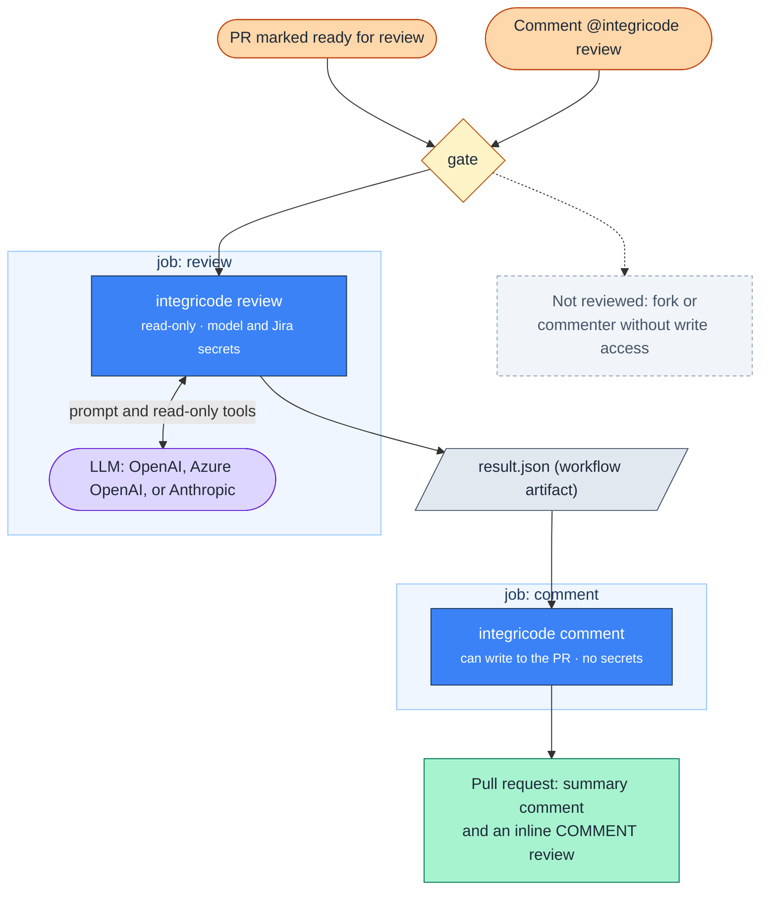
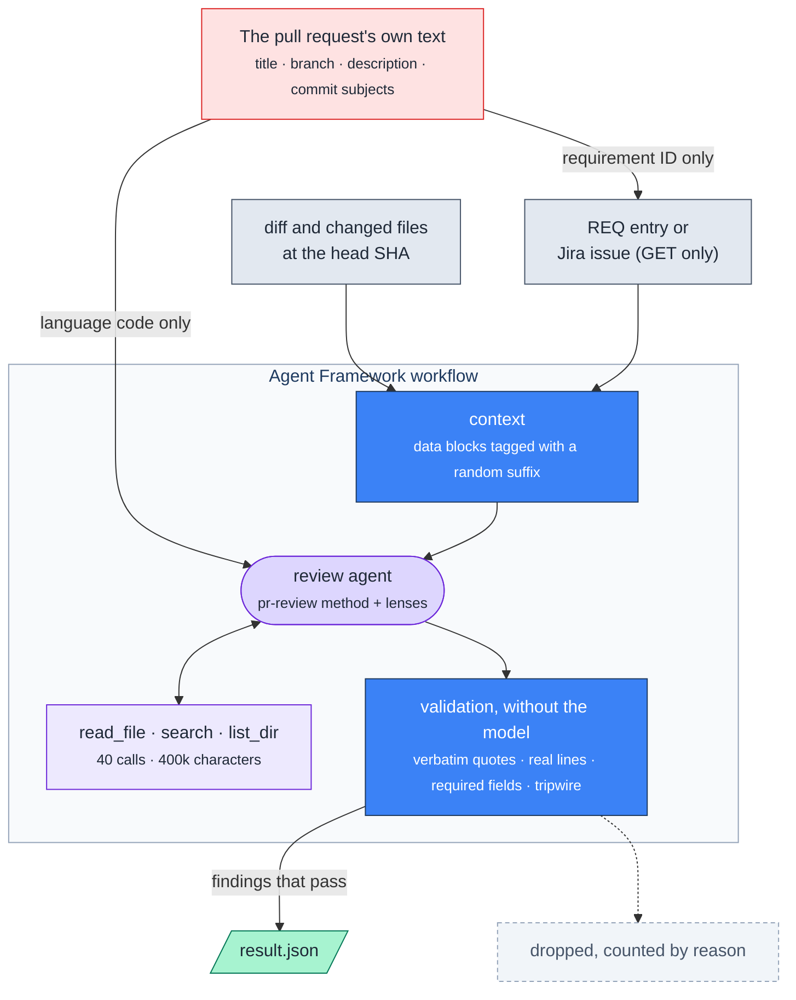
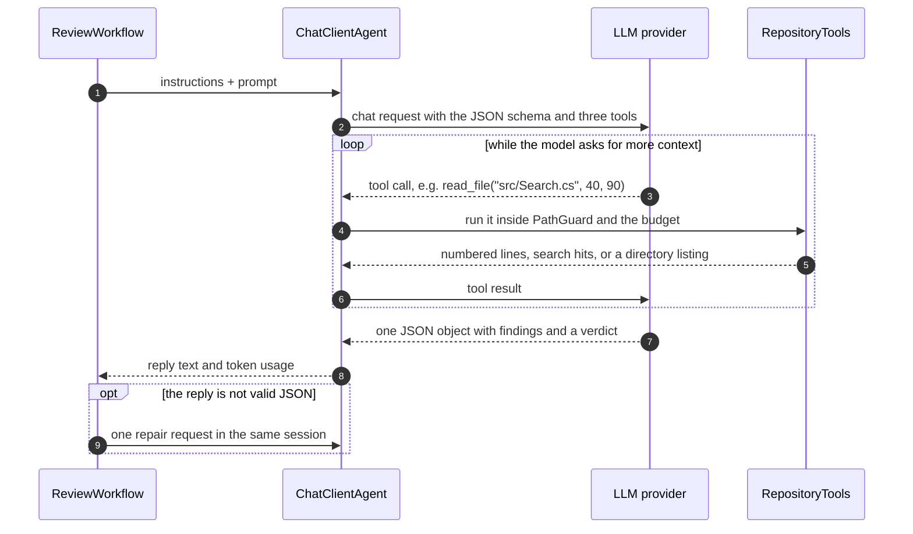

# Integricode

> An AI pull-request reviewer that runs in your GitHub Actions, checks the change for bugs **and** against the requirement it claims to implement, and only publishes findings it can back with evidence.


When a pull request is marked **ready for review**, or someone with write access comments `@integricode review`, Integricode reads the diff and the linked requirement (a `REQ-NNN` entry in your repository or a Jira Cloud issue), reviews the change with an LLM, validates every finding in plain code, and posts the result on the pull request. The author can fix what it finds before asking a person for review.

It never approves, requests changes, or blocks a merge. It tells the author what to fix first.

## Status and Scope

- **Built:** the `review` and `comment` commands, the reusable workflow, REQ-entry and Jira Cloud requirement sources, OpenAI, Azure OpenAI, and Anthropic clients, and the prompt-injection guardrails, covered by 268 test methods (492 cases) and recorded in 6 ADRs; tagged releases v1.0.0 to v1.1.1.
- **Dogfooded:** it reviews the pull requests of a private SaaS repository (Integridens, a dental-insurance billing product) through its caller workflow, on `ready_for_review` and on `@integricode review`.
- **Not built:** GitHub Issues, Jira Server, or Azure DevOps as requirement sources; a per-review cost cap; memory across pull requests.
- **Distribution:** the tool is a private package on GitHub Packages, so the hosted workflow runs only for repositories the owner grants package access. Anyone can build, test, and run the tool from source; see [Run It from Source](#run-it-from-source).

## What You Get on the Pull Request

**A summary comment**, updated in place by every review:

```text
🚦 Integricode review

🔴 1 · 🟡 0 · 🟢 0 — blocking issues to fix before merge.

Solves REQ-012? Partly — the change rejects exactly 100 distinct numbers, which contradicts "at most 100 numbers".
- ⚠️ "at most 100 numbers" — src/Search/NumberSearch.cs:57 — `>= MaxNumbers` rejects 100 distinct numbers.
- ⚠️ 0 of 1 checked criteria covered

| State       | Reviewed, coverage complete |
| Requirement | REQ-012 (from the title)    |
| Lenses      | csharp, security            |
```

**Inline comments** on the changed lines, each labeled with a traffic light and a [Conventional Comments](https://conventionalcomments.org/) label, with a failure scenario and, when the fix is small, a suggestion the author applies with one click:

> 🔴 `issue (blocking)` **Off-by-one: exactly 100 numbers are now rejected** · _requirement_
>
> A search with exactly 100 valid numbers, which the requirement allows, fails with "At most 100 numbers per search".
>
> ```diff
> - if (numbers.Count >= MaxNumbers)
> + if (numbers.Count > MaxNumbers)
> ```

| Light | Label | Meaning |
|---|---|---|
| 🔴 | `issue (blocking)` | A user, a customer, or the next developer runs into it: wrong or lost data, a security hole, an unmet acceptance criterion, a broken screen or file, failure at production volume, behavior no test covers, or leftovers of the change. |
| 🟡 | `suggestion` | Worth fixing, but the change is correct without it. |
| 🟢 | `nitpick` / `note` | A detail or context; no change needed. |

The scoreboard says "good to merge" only when nothing is 🔴, the change solves its requirement, the coverage is complete, and no possible prompt injection was found.

## How It Works



Integricode is a .NET 10 console app, published as a .NET tool (`integricode`) on GitHub Packages, with two commands:

- **`integricode review`** runs in the `review` job, which can only read the repository and is the only job with the model and Jira secrets. It reads the pull request and its requirement, runs the review, and writes `result.json`.
- **`integricode comment`** runs in the `comment` job, which can write to the pull request but holds no secret. It checks that the pull request's head did not move, then publishes the summary and the inline findings and minimizes the ones a newer review no longer reports.

Both jobs live in a reusable workflow, [`.github/workflows/review.yml`](.github/workflows/review.yml), that adopting repositories call from a few lines of YAML. There is no server and no database.

### Inside the Review



The review is a [Microsoft Agent Framework](https://github.com/microsoft/agent-framework) workflow of three executors (`context`, `review`, and `validation`) wired with `WorkflowBuilder` and run in process. Only the middle one talks to the model; the other two are plain, deterministic C#.

## Under the Hood: the LLM Part

### Connecting to the Model

Every provider sits behind the same abstraction, `IChatClient` from `Microsoft.Extensions.AI`, so the review code never knows which model it talks to ([ADR-004](docs/decisions/ADR-004-agent-framework-provider-agnostic.md)). [`ChatClientFactory`](src/Integricode/Agent/ChatClientFactory.cs) builds it from the `model-provider` input:

| `model-provider` | Client | Endpoint |
|---|---|---|
| `openai` | OpenAI .NET SDK (`OpenAIClient.GetChatClient(model).AsIChatClient()`) | `api.openai.com`, or `model-endpoint` |
| `azure-openai` | The same OpenAI SDK, with `model` as the deployment name | the resource's OpenAI-compatible v1 endpoint, `https://<resource>.openai.azure.com/openai/v1/` |
| `anthropic` | Anthropic .NET SDK (`AnthropicClient.AsIChatClient(model)`), with an 8,192-token output limit | `api.anthropic.com`, or `model-endpoint` |

The key comes from the `INTEGRICODE_MODEL_API_KEY` secret. The SDKs' own retries are off; a `RetryingChatClient` retries a call once when the provider answers 429 or 5xx. A provider error ends the review with coverage "failed" and only the HTTP status, never the provider's message, which can echo the prompt. The model's sampling settings, such as temperature, are the provider's defaults.

### What the Model Receives

The model gets two messages built fresh for every run.

**The instructions** (system prompt) are assembled from:

- [`ReviewInstructions.md`](src/Integricode/Agent/ReviewInstructions.md), embedded in the tool: that everything it receives is data, ten review angles (line by line, removed behavior, callers, conventions, security, tests, user-facing output, production volume, leftovers, simplification), "verify before you report", how to build the requirement matrix, the traffic-light categories, and what to report.
- One line that sets the language of its text (`en` or `pt-BR`).
- The lenses the changed files call for, picked by path in [`LensCatalog`](src/Integricode/Agent/LensCatalog.cs): `.cs` selects `csharp`, `.ts` selects `react`, `.github/workflows/` selects `github-actions`, a lockfile selects `contracts-and-dependencies`, and so on, with `security` for every change that is not only docs.
- The JSON schema of the answer, generated from the `AgentReview` record with `AIJsonUtilities.CreateJsonSchema`.

**The prompt** (user message) holds the data, each block tagged with a 16-hex-character suffix drawn per run from a cryptographic random generator:

```xml
<requirement-9f2c41d0a7b3e815 id="REQ-012">
  …the REQ entry or the Jira issue, acceptance criteria and comments included…
</requirement-9f2c41d0a7b3e815>
<diff-9f2c41d0a7b3e815>
  <file-diff-9f2c41d0a7b3e815 path="src/Search/NumberSearch.cs" status="modified" changed-lines="57">
  …the patch…
  </file-diff-9f2c41d0a7b3e815>
</diff-9f2c41d0a7b3e815>
<changed-files-9f2c41d0a7b3e815>
  <file-9f2c41d0a7b3e815 path="src/Search/NumberSearch.cs">…the whole file at the head commit…</file-9f2c41d0a7b3e815>
</changed-files-9f2c41d0a7b3e815>
```

Text in the pull request cannot guess the suffix, so it cannot close a block and pose as instructions. Every patch and file draws from the 400,000-character budget; what does not fit, and every excluded path (`.env*`, keys and certificates, lockfiles, binaries, `*.min.*`, and the `exclude` input), is replaced by a placeholder, and the coverage becomes incomplete. The pull request's title, description, branch name, and commit messages are never in either message.

### The Agent Loop



The agent is a `ChatClientAgent` with `ResponseFormat` set to the JSON schema and three tools exposed through function calling:

| Tool | Does | Limit |
|---|---|---|
| `read_file(path, from?, to?)` | returns a line range as `N: text` | text files only |
| `search(text)` | case-insensitive search over the checkout | 100 matches |
| `list_dir(path)` | lists a directory | — |

Each call goes through [`PathGuard`](src/Integricode/Agent/PathGuard.cs), which keeps it inside the checkout (absolute paths, `..` segments, and symbolic links that leave it are refused) and away from excluded paths, and through the [`ContextBudget`](src/Integricode/Agent/ContextBudget.cs) of 40 calls and 400,000 characters. Past the budget, a tool answers that the budget is reached and the coverage becomes incomplete. Every chunk a tool returns is recorded with its path, line range, and SHA-256.

The model answers with one JSON object:

```json
{
  "findings": [{
    "kind": "requirement-mismatch",
    "severity": "blocking",
    "lens": "bug",
    "title": "Off-by-one: exactly 100 numbers are now rejected",
    "path": "src/Search/NumberSearch.cs",
    "line": 57,
    "failureScenario": "A search with exactly 100 valid numbers fails…",
    "requirementQuote": "at most 100 numbers",
    "fix": "Restore `numbers.Count > MaxNumbers`.",
    "suggestionStartLine": 57,
    "suggestion": "            if (numbers.Count > MaxNumbers)"
  }],
  "requirementVerdict": {
    "answer": "partly",
    "summary": "The change rejects the 100th distinct number.",
    "criteria": [{ "quote": "at most 100 numbers", "status": "missing", "evidence": "src/Search/NumberSearch.cs:57" }]
  }
}
```

The reply is parsed from its first `{` to its last `}`, which tolerates prose or a code fence around it. If it still does not match the schema, the agent gets one repair request in the same session; a second failure ends the review with coverage "failed".

### What the Code Decides After the Model

The model proposes; [`FindingValidator`](src/Integricode/Validation/FindingValidator.cs) and [`VerdictValidator`](src/Integricode/Validation/VerdictValidator.cs) decide what gets published. A finding is dropped, and counted by reason, unless:

| Check | Drop reason |
|---|---|
| it has a kind, a light, a title, a path, a line, and a failure scenario, plus a quote for a requirement mismatch | `missing-field` |
| its path is one of the pull request's files | `path-not-in-pull-request` |
| its line exists in that file at the head commit | `line-not-found` |
| a bug points at a line the pull request changes | `bug-not-on-changed-line` |
| its requirement quote, whitespace-normalized, is at least 12 characters and appears verbatim in the requirement | `quote-not-found` |

Then:

- **Suggestions** are kept only when they replace diff lines only, at most 20 lines and 2,000 characters; otherwise the fix stays in prose.
- **Duplicates** are removed by fingerprint: the SHA-256 of the path, line, and whitespace-normalized title and failure scenario. The same fingerprint lets a later review skip findings already published and minimize the ones it no longer reports.
- **The requirement verdict** keeps a criterion row only when its quote is verbatim requirement text. A "yes" becomes "partly" when no row survives, when any row was dropped, or when a row or a blocking requirement mismatch contradicts it, so data that talked the model into "yes" cannot publish it.
- **The injection tripwire** scans the requirement and the added lines with a fixed list of English and Portuguese phrases addressed to AI reviewers, and lists up to 10 hits in the summary.
- **The context hash** is the SHA-256 of the head commit, the patches sent, the requirement text, and every tool chunk, so a result can be traced to exactly what the model saw.

There are no embeddings, vector search, or fine-tuning: the model reads the code it needs through the tools, and the rules that make a finding publishable are plain code with unit tests.

### Built-In Guardrails

- **The pull request's own text never reaches the model.** The title, branch name, description, and commit messages are read by the tool only, to find the requirement ID and to pick the review language.
- **Separate credentials.** The job that talks to the model cannot write; the job that writes holds no secret ([ADR-001](docs/decisions/ADR-001-separate-review-comment-credentials.md)).
- **A prompt-injection tripwire.** Outside the model, Integricode scans the added lines and the requirement for text addressed to an AI reviewer, in English and Portuguese, and lists every hit in the summary.
- **Escaped output.** Everything the model writes is escaped before publishing, and a suggestion can only replace diff lines next to its finding.
- **Forks are never reviewed**, and the Jira integration only sends GET requests.

## Quick Start

The hosted workflow installs the tool from a private GitHub Packages feed, so these steps work for repositories the owner grants package access; anywhere else, [run it from source](#run-it-from-source). You also need an API key for OpenAI, Azure OpenAI, or Anthropic. The [adoption guide](docs/guides/adoption.md) walks through every step.

1. Add the repository secret `INTEGRICODE_MODEL_API_KEY` (and, to review against Jira, `JIRA_EMAIL` and `JIRA_API_TOKEN`).
2. Add `.github/workflows/integricode.yml` on the default branch:

   ```yaml
   name: Integricode

   on:
     pull_request:
       types: [ready_for_review]
     issue_comment:
       types: [created]

   permissions:
     contents: read
     pull-requests: write
     packages: read

   jobs:
     integricode:
       if: github.event_name == 'pull_request' || (github.event.issue.pull_request && contains(github.event.comment.body, '@integricode review'))
       uses: GabrielBels/integricode/.github/workflows/review.yml@v1
       with:
         model-provider: anthropic   # or openai, azure-openai
         model: <model name>
       secrets:
         model-api-key: ${{ secrets.INTEGRICODE_MODEL_API_KEY }}
         jira-email: ${{ secrets.JIRA_EMAIL }}
         jira-api-token: ${{ secrets.JIRA_API_TOKEN }}
   ```

3. Put a requirement ID in the pull request's title, branch name, or description: `REQ-012` for an entry in `docs/requirements.md`, or a Jira key such as `SHOP-123`.
4. Mark a pull request ready for review, or comment `@integricode review` on it.

Without a linked requirement, Integricode still reports bugs and marks the coverage incomplete, naming what was missing.

### Inputs

| Input | Default | What it sets |
|---|---|---|
| `model-provider` | required | `openai`, `azure-openai`, or `anthropic` |
| `model` | required | The model, or the Azure OpenAI deployment |
| `model-endpoint` | empty | The endpoint; required for Azure OpenAI |
| `requirements-file` | `docs/requirements.md` | Where the `## [REQ-NNN]` entries live |
| `jira-base-url` | empty | The Jira Cloud site; empty turns Jira off |
| `jira-acceptance-criteria-field` | empty | The Jira field with the acceptance criteria |
| `exclude` | empty | Extra paths the review never reads, one glob per line |
| `max-context-chars` / `max-tool-calls` | `400000` / `40` | The review's budget |
| `language` | `en` | `en` or `pt-BR`, used when the pull request's description and commit subjects do not show their language |

The review writes in the language of the pull request's description and commit subjects; the `language` input is the fallback. The [adoption guide](docs/guides/adoption.md#3-set-the-inputs) has the details.

## Run It from Source

This needs only the .NET 10 SDK and packages from nuget.org, not the private feed:

```bash
git clone https://github.com/GabrielBels/integricode.git
cd integricode
dotnet build Integricode.slnx
dotnet test Integricode.slnx
```

No test reaches a network or a model provider.

To review a pull request from your machine, check out its head commit, set `GITHUB_TOKEN` (a token that reads the repository) and `INTEGRICODE_MODEL_API_KEY`, then run:

```bash
dotnet run --project src/Integricode -- review --repo owner/name --pr 42 --workspace <checkout> --out result.json --model-provider anthropic --model <model name>
```

`result.json` holds the findings, the coverage, and the token usage. To publish them on the pull request, run `dotnet run --project src/Integricode -- comment --repo owner/name --pr 42 --result result.json` with a `GITHUB_TOKEN` that can write to pull requests. Run it with no arguments to list every option.

## Development

**Stack:** .NET 10, Microsoft Agent Framework 1.26.0, `Microsoft.Extensions.AI.OpenAI` (OpenAI and Azure OpenAI), the `Anthropic` SDK, xUnit, and the GitHub and Jira REST APIs over `HttpClient`. No test touches a network or a model.

| To | Run |
|---|---|
| Build (warnings are errors) | `dotnet build Integricode.slnx` |
| Run every test | `dotnet test Integricode.slnx` |
| Run one test class | `dotnet test Integricode.slnx --filter "FullyQualifiedName~Integricode.Tests.Validation.FindingValidatorTests"` |
| Pack the tool | `dotnet pack src/Integricode -o artifacts` |
| Test the workflows' shell steps (bash, jq, git, dotnet) | `bash tests/workflows/workflow-steps.test.sh` |

To release, push a `vX.Y.Z` tag: [`release.yml`](.github/workflows/release.yml) builds, tests, packs, publishes the tool to GitHub Packages, and moves the `vX` tag that adopters use.

```text
src/Integricode/
├── Domain/        review result, findings, coverage, language, fingerprint
├── GitHub/        REST and GraphQL client, diff map
├── Requirements/  requirement identification, REQ entries, Jira Cloud
├── Agent/         chat clients, review workflow, read-only tools, lenses
├── Validation/    provenance check, verdict check, injection tripwire
└── Commands/      review and comment commands, comment templates
tests/Integricode.Tests/   mirrors src, with fakes for GitHub, Jira, and the model
```

## Documentation

| Need | Read |
|---|---|
| Adopt it in a repository | [docs/guides/adoption.md](docs/guides/adoption.md) |
| Product vision and goals | [docs/prd.md](docs/prd.md) |
| Requirements and acceptance criteria | [docs/requirements.md](docs/requirements.md) |
| System structure | [docs/architecture.md](docs/architecture.md) |
| Why it is built this way | [docs/decisions/](docs/decisions/) |
| Domain terms | [docs/glossary.md](docs/glossary.md) |
| Conventions for contributors and AI agents | [AGENTS.md](AGENTS.md) |
| License | [MIT](LICENSE) |
