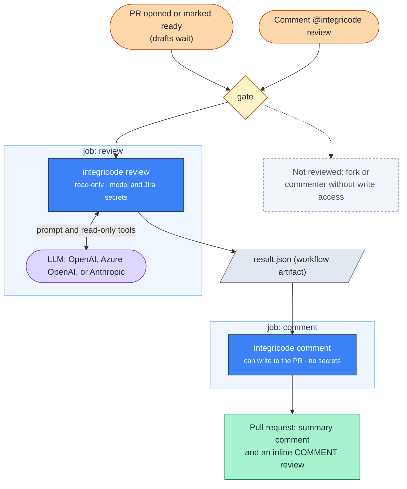

# Integricode

> An AI pull-request reviewer that runs in your GitHub Actions, checks the change for bugs **and** against the requirement it claims to implement, and only publishes findings it can back with evidence.


When a pull request opens (not as a draft) or is marked **ready for review**, or someone with write access comments `@integricode review`, Integricode reads the diff and the linked requirement (a `REQ-NNN` entry in your repository or a Jira Cloud issue), reviews the change with an LLM, validates every finding in plain code, and posts the result on the pull request. The author can fix what it finds before asking a person for review.

It never approves, requests changes, or blocks a merge. It tells the author what to fix first.

## Status and Scope

- **Built:** the `review` and `comment` commands, the reusable workflow, REQ-entry and Jira Cloud requirement sources, OpenAI, Azure OpenAI, and Anthropic clients, and the prompt-injection guardrails, covered by 268 test methods (492 cases) and recorded in 6 ADRs; tagged releases v1.0.0 to v1.1.1.
- **Dogfooded:** it reviews the pull requests of a private SaaS repository (Integridens, a dental-insurance billing product) through its caller workflow, on `ready_for_review` and on `@integricode review`.
- **Not built:** GitHub Issues, Jira Server, or Azure DevOps as requirement sources; a per-review cost cap; memory across pull requests.
- **Distribution:** the tool is a private package on GitHub Packages, so the hosted workflow runs only for repositories the owner grants package access. Anyone can build, test, and run the tool from source; see [Run It from Source](#run-it-from-source).

## What You Get on the Pull Request

To see it on a real pull request, open [integricode-demo#1](https://github.com/GabrielBels/integricode-demo/pull/1). It caps a search at 100 numbers with an off-by-one written in on purpose; its 8 tests pass, and Integricode flags the bug and the missing boundary tests. The excerpts below come from that review.

**A summary comment**, updated in place by every review:

```text
🚦 Integricode review

🔴 4 · 🟡 0 · 🟢 0 — blocking issues to fix before merge.

Solves REQ-001? No — The limit is off by one: `>=` rejects exactly 100 numbers. The tests skip the 100/101 boundary, so they don't catch it.
- ❌ "A search accepts at most 100 numbers." — src/Search/NumberSearch.cs:39 uses >=, so 100 numbers are rejected
- ❌ "Tests cover the boundary: 100 numbers pass, 101 are rejected." — tests/Search.Tests/NumberSearchTests.cs:24,29 use 50 and 150
- ⚠️ 2 of 4 checked criteria covered

| State                           | Reviewed, coverage complete               |
| Requirement                     | REQ-001 (from the title)                  |
| Findings                        | 2 requirement mismatches, 2 code findings |
| Dropped by the provenance check | 0                                         |
| Lenses                          | csharp, security                          |
```

**Inline comments** on the changed lines, each labeled with a traffic light and a [Conventional Comments](https://conventionalcomments.org/) label, with a failure scenario and, when the fix is small, a suggestion the author applies with one click:

> 🔴 `issue (blocking)` **Off-by-one: a search with exactly 100 numbers is rejected** · _requirement_
>
> > A search accepts at most 100 numbers.
>
> A user pastes exactly 100 distinct order numbers. Because the check is `numbers.Count >= MaxNumbers`, the parser throws "At most 100 numbers per search." and the valid search is refused.
>
> ```diff
> - if (numbers.Count >= MaxNumbers)
> + if (numbers.Count > MaxNumbers)
> ```

| Light | Label | Meaning |
|---|---|---|
| 🔴 | `issue (blocking)` | A user, a customer, or the next developer runs into it: wrong or lost data, a security hole, an unmet acceptance criterion, a broken screen or file, failure at production volume, behavior no test covers, or leftovers of the change. |
| 🟡 | `suggestion` | Worth fixing, but the change is correct without it. |
| 🟢 | `nitpick` / `note` | A detail or context; no change needed. |

The scoreboard says "good to merge" only when nothing is 🔴, the change solves its requirement, the coverage is complete, and no possible prompt injection was found.

## How It Works



Integricode is a .NET 10 tool with two commands, run by a reusable workflow, [`.github/workflows/review.yml`](.github/workflows/review.yml). There is no server and no database.

- **`integricode review`** runs in a job that can only read the repository and is the only one with the model and Jira secrets. It reads the pull request and its requirement, runs a [Microsoft Agent Framework](https://github.com/microsoft/agent-framework) review, and writes `result.json`.
- **`integricode comment`** runs in a job that can write to the pull request but holds no secret. It checks that the head did not move, then publishes the findings and minimizes the ones a newer review no longer reports.

Guardrails:

- **The pull request's own text never reaches the model.** The title, branch name, description, and commit messages are read by the tool only, to find the requirement ID and to pick the review language.
- **Separate credentials.** The job that talks to the model cannot write; the job that writes holds no secret ([ADR-001](docs/decisions/ADR-001-separate-review-comment-credentials.md)).
- **Findings are checked in code.** A finding whose path, line, or requirement quote does not match the pull request is dropped, and a "yes" verdict the evidence does not support becomes "partly".
- **A prompt-injection tripwire.** Outside the model, Integricode scans the added lines and the requirement for text addressed to an AI reviewer, in English and Portuguese, and lists every hit in the summary.
- **Forks are never reviewed**, everything the model writes is escaped before publishing, and the Jira integration only sends GET requests.

The prompt, the agent loop, and every validation rule are in [How Integricode Works](docs/guides/how-it-works.md).

## Quick Start

You need an API key for OpenAI, Azure OpenAI, or Anthropic.

### Use the Hosted Workflow

The workflow installs the tool from a private GitHub Packages feed, so this works for repositories the owner grants package access; anywhere else, [run it from source](#run-it-from-source). The [adoption guide](docs/guides/adoption.md) covers every step and input.

1. Add one repository secret per model provider you use, `INTEGRICODE_ANTHROPIC_API_KEY`, `INTEGRICODE_OPENAI_API_KEY`, or `INTEGRICODE_AZURE_OPENAI_API_KEY` (and, to review against Jira, `JIRA_EMAIL` and `JIRA_API_TOKEN`). The caller passes the one that matches `model-provider` as `model-api-key`.
2. Add `.github/workflows/integricode.yml` on the default branch:

   ```yaml
   name: Integricode

   on:
     pull_request:
       types: [opened, ready_for_review]
     issue_comment:
       types: [created]

   permissions:
     contents: read
     pull-requests: write
     packages: read

   jobs:
     integricode:
       if: github.event_name == 'pull_request' || (github.event.issue.pull_request && contains(github.event.comment.body, '@integricode review'))
       uses: GabrielBels/integricode/.github/workflows/review.yml@v1
       with:
         model-provider: anthropic   # or openai, azure-openai, with that provider's secret below
         model: <model name>
       secrets:
         model-api-key: ${{ secrets.INTEGRICODE_ANTHROPIC_API_KEY }}
         jira-email: ${{ secrets.JIRA_EMAIL }}
         jira-api-token: ${{ secrets.JIRA_API_TOKEN }}
   ```

   To choose when it runs, list the actions in `types` and in the `review-on` input (default `opened ready_for_review`), and set `review-drafts: true` to review drafts too. Left unset, a pull request is reviewed when it opens as ready or a draft is marked ready, never as a draft or on a push.

3. Put a requirement ID in the pull request's title, branch name, or description: `REQ-012` for an entry in `docs/requirements.md`, or a Jira key such as `SHOP-123`. Without one, Integricode still reports bugs and marks the coverage incomplete.
4. Open a pull request that is not a draft, mark a draft ready for review, or comment `@integricode review` on it.

### Run It from Source

This needs only the .NET 10 SDK and packages from nuget.org, not the private feed:

```bash
git clone https://github.com/GabrielBels/integricode.git
cd integricode
dotnet build Integricode.slnx
dotnet test Integricode.slnx
```

To review a pull request from your machine, check out its head commit, set `GITHUB_TOKEN` (a token that reads the repository) and `INTEGRICODE_MODEL_API_KEY` (the key of the provider you pass as `--model-provider`), then run:

```bash
dotnet run --project src/Integricode -- review --repo owner/name --pr 42 --workspace <checkout> --out result.json --model-provider anthropic --model <model name>
```

`result.json` holds the findings, the coverage, and the token usage. To publish them on the pull request, run `dotnet run --project src/Integricode -- comment --repo owner/name --pr 42 --result result.json` with a `GITHUB_TOKEN` that can write to pull requests. Run it with no arguments to list every option.

## Development

**Stack:** .NET 10, Microsoft Agent Framework 1.26.0, `Microsoft.Extensions.AI.OpenAI` (OpenAI and Azure OpenAI), the `Anthropic` SDK, xUnit, and the GitHub and Jira REST APIs over `HttpClient`.

| To | Run |
|---|---|
| Build (warnings are errors) | `dotnet build Integricode.slnx` |
| Run every test (no network, no model) | `dotnet test Integricode.slnx` |
| Run one test class | `dotnet test Integricode.slnx --filter "FullyQualifiedName~Integricode.Tests.Validation.FindingValidatorTests"` |
| Pack the tool | `dotnet pack src/Integricode -o artifacts` |
| Test the workflows' shell steps (bash, jq, git, dotnet) | `bash tests/workflows/workflow-steps.test.sh` |

To release, push a `vX.Y.Z` tag: [`release.yml`](.github/workflows/release.yml) builds, tests, packs, publishes the tool to GitHub Packages, and moves the `vX` tag that adopters use.

## Documentation

| Need | Read |
|---|---|
| Adopt it in a repository | [docs/guides/adoption.md](docs/guides/adoption.md) |
| The prompt, the agent loop, and the validation rules | [docs/guides/how-it-works.md](docs/guides/how-it-works.md) |
| An architecture walkthrough (slides and deep dive) | [docs/assets/architecture-review/](docs/assets/architecture-review/) |
| System structure | [docs/architecture.md](docs/architecture.md) |
| Why it is built this way | [docs/decisions/](docs/decisions/) |
| Product vision, requirements, and acceptance criteria | [docs/prd.md](docs/prd.md), [docs/requirements.md](docs/requirements.md) |
| Domain terms | [docs/glossary.md](docs/glossary.md) |
| Conventions for contributors and AI agents | [AGENTS.md](AGENTS.md) |
| License | [MIT](LICENSE) |
