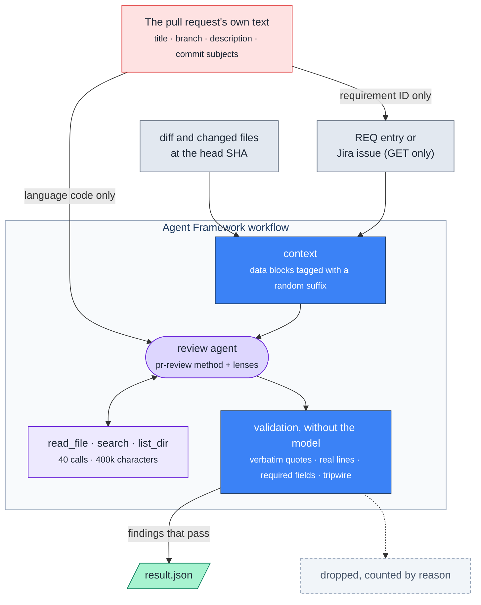
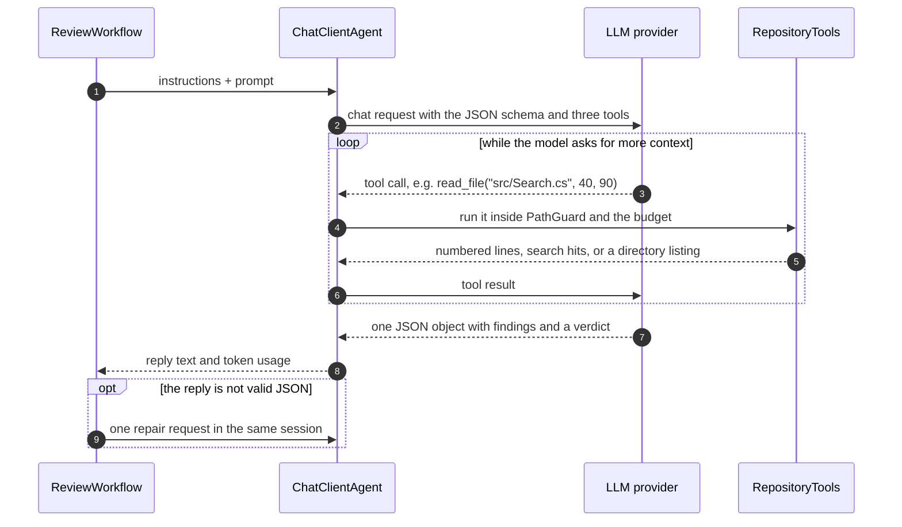

# How Integricode Works

The internals behind the [README](../../README.md): the review workflow, how it talks to the model, what the model receives, and the plain code that decides what gets published.

## Inside the Review



The review is a [Microsoft Agent Framework](https://github.com/microsoft/agent-framework) workflow of three executors (`context`, `review`, and `validation`) wired with `WorkflowBuilder` and run in process. Only the middle one talks to the model; the other two are plain, deterministic C#.

## Connecting to the Model

Every provider sits behind the same abstraction, `IChatClient` from `Microsoft.Extensions.AI`, so the review code never knows which model it talks to ([ADR-004](../decisions/ADR-004-agent-framework-provider-agnostic.md)). [`ChatClientFactory`](../../src/Integricode/Agent/ChatClientFactory.cs) builds it from the `model-provider` input:

| `model-provider` | Client | Endpoint |
|---|---|---|
| `openai` | OpenAI .NET SDK (`OpenAIClient.GetChatClient(model).AsIChatClient()`) | `api.openai.com`, or `model-endpoint` |
| `azure-openai` | The same OpenAI SDK, with `model` as the deployment name | the resource's OpenAI-compatible v1 endpoint, `https://<resource>.openai.azure.com/openai/v1/` |
| `anthropic` | Anthropic .NET SDK (`AnthropicClient.AsIChatClient(model)`), with an 8,192-token output limit | `api.anthropic.com`, or `model-endpoint` |

The key comes from the `INTEGRICODE_MODEL_API_KEY` secret. The SDKs' own retries are off; a `RetryingChatClient` retries a call once when the provider answers 429 or 5xx. A provider error ends the review with coverage "failed" and only the HTTP status, never the provider's message, which can echo the prompt. The model's sampling settings, such as temperature, are the provider's defaults.

## What the Model Receives

The model gets two messages built fresh for every run.

**The instructions** (system prompt) are assembled from:

- [`ReviewInstructions.md`](../../src/Integricode/Agent/ReviewInstructions.md), embedded in the tool: that everything it receives is data, ten review angles (line by line, removed behavior, callers, conventions, security, tests, user-facing output, production volume, leftovers, simplification), "verify before you report", how to build the requirement matrix, the traffic-light categories, and what to report.
- One line that sets the language of its text (`en` or `pt-BR`).
- The lenses the changed files call for, picked by path in [`LensCatalog`](../../src/Integricode/Agent/LensCatalog.cs): `.cs` selects `csharp`, `.ts` selects `react`, `.github/workflows/` selects `github-actions`, a lockfile selects `contracts-and-dependencies`, and so on, with `security` for every change that is not only docs.
- The JSON schema of the answer, generated from the `AgentReview` record with `AIJsonUtilities.CreateJsonSchema`.

**The prompt** (user message) holds the data, each block tagged with a 16-hex-character suffix drawn per run from a cryptographic random generator:

```xml
<requirement-9f2c41d0a7b3e815 id="REQ-012">
  …the REQ entry or the Jira issue, acceptance criteria and comments included…
</requirement-9f2c41d0a7b3e815>
<diff-9f2c41d0a7b3e815>
  <file-diff-9f2c41d0a7b3e815 path="src/Search/NumberSearch.cs" status="modified" changed-lines="57">
  …the patch…
  </file-diff-9f2c41d0a7b3e815>
</diff-9f2c41d0a7b3e815>
<changed-files-9f2c41d0a7b3e815>
  <file-9f2c41d0a7b3e815 path="src/Search/NumberSearch.cs">…the whole file at the head commit…</file-9f2c41d0a7b3e815>
</changed-files-9f2c41d0a7b3e815>
```

Text in the pull request cannot guess the suffix, so it cannot close a block and pose as instructions. Every patch and file draws from the 400,000-character budget; what does not fit, and every excluded path (`.env*`, keys and certificates, lockfiles, binaries, `*.min.*`, and the `exclude` input), is replaced by a placeholder, and the coverage becomes incomplete. The pull request's title, description, branch name, and commit messages are never in either message.

## The Agent Loop



The agent is a `ChatClientAgent` with `ResponseFormat` set to the JSON schema and three tools exposed through function calling:

| Tool | Does | Limit |
|---|---|---|
| `read_file(path, from?, to?)` | returns a line range as `N: text` | text files only |
| `search(text)` | case-insensitive search over the checkout | 100 matches |
| `list_dir(path)` | lists a directory | — |

Each call goes through [`PathGuard`](../../src/Integricode/Agent/PathGuard.cs), which keeps it inside the checkout (absolute paths, `..` segments, and symbolic links that leave it are refused) and away from excluded paths, and through the [`ContextBudget`](../../src/Integricode/Agent/ContextBudget.cs) of 40 calls and 400,000 characters. Past the budget, a tool answers that the budget is reached and the coverage becomes incomplete. Every chunk a tool returns is recorded with its path, line range, and SHA-256.

The model answers with one JSON object:

```json
{
  "findings": [{
    "kind": "requirement-mismatch",
    "severity": "blocking",
    "lens": "bug",
    "title": "Off-by-one: exactly 100 numbers are now rejected",
    "path": "src/Search/NumberSearch.cs",
    "line": 57,
    "failureScenario": "A search with exactly 100 valid numbers fails…",
    "requirementQuote": "at most 100 numbers",
    "fix": "Restore `numbers.Count > MaxNumbers`.",
    "suggestionStartLine": 57,
    "suggestion": "            if (numbers.Count > MaxNumbers)"
  }],
  "requirementVerdict": {
    "answer": "partly",
    "summary": "The change rejects the 100th distinct number.",
    "criteria": [{ "quote": "at most 100 numbers", "status": "missing", "evidence": "src/Search/NumberSearch.cs:57" }]
  }
}
```

The reply is parsed from its first `{` to its last `}`, which tolerates prose or a code fence around it. If it still does not match the schema, the agent gets one repair request in the same session; a second failure ends the review with coverage "failed".

## What the Code Decides After the Model

The model proposes; [`FindingValidator`](../../src/Integricode/Validation/FindingValidator.cs) and [`VerdictValidator`](../../src/Integricode/Validation/VerdictValidator.cs) decide what gets published. A finding is dropped, and counted by reason, unless:

| Check | Drop reason |
|---|---|
| it has a kind, a light, a title, a path, a line, and a failure scenario, plus a quote for a requirement mismatch | `missing-field` |
| its path is one of the pull request's files | `path-not-in-pull-request` |
| its line exists in that file at the head commit | `line-not-found` |
| a bug points at a line the pull request changes | `bug-not-on-changed-line` |
| its requirement quote, whitespace-normalized, is at least 12 characters and appears verbatim in the requirement | `quote-not-found` |

Then:

- **Suggestions** are kept only when they replace diff lines only, at most 20 lines and 2,000 characters; otherwise the fix stays in prose.
- **Duplicates** are removed by fingerprint: the SHA-256 of the path, line, and whitespace-normalized title and failure scenario. The same fingerprint lets a later review skip findings already published and minimize the ones it no longer reports.
- **The requirement verdict** keeps a criterion row only when its quote is verbatim requirement text. A "yes" becomes "partly" when no row survives, when any row was dropped, or when a row or a blocking requirement mismatch contradicts it, so data that talked the model into "yes" cannot publish it.
- **The injection tripwire** scans the requirement and the added lines with a fixed list of English and Portuguese phrases addressed to AI reviewers, and lists up to 10 hits in the summary.
- **The context hash** is the SHA-256 of the head commit, the patches sent, the requirement text, and every tool chunk, so a result can be traced to exactly what the model saw.

There are no embeddings, vector search, or fine-tuning: the model reads the code it needs through the tools, and the rules that make a finding publishable are plain code with unit tests.

## Code Layout

```text
src/Integricode/
├── Domain/        review result, findings, coverage, language, fingerprint
├── GitHub/        REST and GraphQL client, diff map
├── Requirements/  requirement identification, REQ entries, Jira Cloud
├── Agent/         chat clients, review workflow, read-only tools, lenses
├── Validation/    provenance check, verdict check, injection tripwire
└── Commands/      review and comment commands, comment templates
tests/Integricode.Tests/   mirrors src, with fakes for GitHub, Jira, and the model
```
