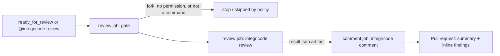

# Pull-Request Review Action Design

> Design date: 2026-10-30
> Status: Approved
> Current stage: Approved
> Last checkpoint: 2026-10-30T12:55:22-03:00
> Next action: Run /define-goal REQ-001

## Overview

The technical design of [PRD-001](../prds/PRD-001-pull-request-review-action.md): the whole Integricode product, a GitHub Action that reviews a pull request for bugs and against its Jira Cloud issue or REQ entry, validates every finding's references deterministically, and publishes them on the pull request for the author. The PRD's functional requirements, non-goals, non-functional requirements, and release criteria are settled input. The work ships as three REQs: REQ-001 (review core with REQ entries), REQ-002 (Jira Cloud source), and REQ-003 (GitHub Action and package).

## Codebase Analysis

- The repository holds only docs; there is no code, build, or CI yet.
- The owner's .NET conventions, taken from `casa-de-racoes`: .NET 10 with `global.json` pinning SDK `10.0.403` (`rollForward: latestPatch`), a `.slnx` solution, `Directory.Build.props`, central package management in `Directory.Packages.props`, and xUnit (`xunit` 2.9.3, `xunit.runner.visualstudio` 3.1.5, `Microsoft.NET.Test.Sdk` 18.4.0). SDK `10.0.403` is installed on the owner's machine.
- Production dependencies, checked on nuget.org on 2026-10-30 and approved by the owner:

| Package | Version | License | Notes |
|---|---|---|---|
| `Microsoft.Agents.AI` | 1.26.0 | MIT | Stable, Microsoft, weekly releases |
| `Microsoft.Agents.AI.Workflows` | 1.26.0 | MIT | `WorkflowBuilder` and executors |
| `Microsoft.Extensions.AI.OpenAI` | 10.11.0 | MIT | OpenAI and Azure OpenAI (v1 endpoint) through `IChatClient`; brings `OpenAI` 2.14.0 |
| `Anthropic` | 13.3.0 | Apache-2.0 | Official Claude SDK for C# |

GitHub and Jira are called through `HttpClient` and `System.Text.Json`; command-line parsing and logging use the platform, so no other production package is added.

## Architecture

- **Distribution.** One .NET tool (`PackAsTool`, command `integricode`), packed from `src/Integricode/` and published as a private package on GitHub Packages. The reusable workflow `.github/workflows/review.yml` in this private repository installs it with `--version 1.*`, matching the workflow's `v1` tag. Both jobs install it with the caller's `GITHUB_TOKEN` and `packages: read`, the package's Actions access gives each adopting repository the Read role (ADR-005), and the repository's Actions access setting allows repositories owned by `GabrielBels`.
- **Two jobs, two credentials.** The `review` job runs with `contents: read`, `pull-requests: read`, and `packages: read` and receives the model key and the Jira secrets. It never holds a write permission. The `comment` job runs with `pull-requests: write` and `packages: read` and receives no secret. It posts only what the result file carries, through fixed templates. ADR-001 records this decision.
- **Commands.** `integricode review` reads the event, the pull request, the requirement, and the code, runs the agent workflow, validates the findings, and writes `result.json`. `integricode comment` reads `result.json`, checks that the head SHA is still current, and publishes. The `review` job's gate (event filter, fork check, commenter permission) is a shell step using `gh api`, because a fork's run has no secret to install the tool (REQ-003).
- **Source layout.** `src/Integricode/` holds one project with folders `Domain/` (result, findings, coverage, snapshot), `GitHub/` (REST client), `Requirements/` (identification, REQ source; `Jira/` in REQ-002), `Agent/` (chat client factory, repository tools, MAF workflow), `Validation/`, and `Commands/`. `tests/Integricode.Tests/` mirrors those folders.

## Review Flow

1. **Identify the requirement (FR-4).** The first match, in the order title, branch name, description, of a REQ ID (`REQ-\d{3}`) or a Jira Cloud key (`[A-Z][A-Z0-9]{1,9}-\d+`). The summary names the one used.
2. **Read it (FR-5, FR-6).** A REQ entry is the `## [REQ-NNN]` section of the configured requirements file at the head SHA. A Jira issue is its summary, description, acceptance criteria (configured custom field, else the description), and comments, converted from Atlassian Document Format to text, without author names. Until REQ-002 ships, a Jira key yields incomplete coverage ("Jira source not configured").
3. **Gather context (FR-8).** The fixed input is the diff with line maps, the full content of the changed files at the head SHA, and the requirement text. Excluded paths (`.env*`, key and certificate files, lockfiles, binaries, `*.min.*`, and the configured globs) are never read. Each data block is wrapped in tags whose names end with a random per-run boundary, with escaped attribute values, so file names and file text cannot close a block; the pull request's title, description, branch name, and commit messages are never sent (ADR-006).
4. **Review (agent).** A `WorkflowBuilder` workflow runs three executors: context, review, and validation. The review executor is a `ChatClientAgent` whose output is a `ReviewResult` (findings with kind, light, lens, title, path, line, failure scenario, fix, optional suggestion, and requirement quote for a mismatch, plus a requirement verdict with one row per criterion). Its instructions carry the `pr-review` method (review angles, traffic-light categories, risk table) and the lenses the pull request's files call for, embedded from `Agent/Lenses/`, in the configured language (ADR-006). It has three read-only tools over the head-SHA checkout: `read_file(path, from, to)`, `search(pattern)`, and `list_dir(path)`. The tools refuse excluded paths and paths outside the checkout. They stop at 40 calls or 400,000 characters read, after which the coverage is incomplete. Bug findings may only point at changed lines (FR-10); everything else is for understanding call chains. ADR-002 records this boundary.
5. **Snapshot.** The context hash is SHA-256 over a canonical serialization of the head SHA, the diff, the requirement text, and every chunk the tools returned, in order.
6. **Validate (FR-9 to FR-11).** A finding is dropped when its requirement quote (whitespace-normalized) is not a substring of the requirement text, its path is not a file of the pull request, its line does not exist at the head SHA, a bug's line is not a changed line, or it lacks a light or a failure scenario. Duplicate fingerprints (path, line, normalized text) collapse. A suggestion survives only when every line it replaces is a diff line, it is not empty, and it has at most 20 lines and 2,000 characters. A verdict row is dropped when its quote is not verbatim requirement text, and a "yes" without a surviving row, with any row dropped, or that a row or a blocking requirement mismatch contradicts becomes "partly". The injection tripwire scans the added lines (whole files sent without their patch, except a rename that adds no line) and the requirement for phrases aimed at AI reviewers, outside the model. The result reports dropped counts by reason.
7. **Publish (FR-12 to FR-15).** The `comment` job first compares the pull request's current head SHA with the result's. On a mismatch it publishes no findings and updates the summary to "superseded". Otherwise it upserts one summary comment, identified by a hidden marker. The summary opens with the scoreboard by light and a merge verdict, then the requirement verdict with the criteria not covered, findings without a diff line, and injection warnings, then a table with the coverage, head SHA, counts by kind, dropped count, and lenses, and a hidden JSON record of findings and usage (FR-17). The `comment` job creates one pull-request review with event `COMMENT` holding an inline comment per finding on a diff line (light and label, headline, lens, scenario, fix, and suggestion, anchored on the suggestion's range), and skips fingerprints already published. Earlier Integricode comments absent from the current result are minimized as outdated. Model-written text is length-limited, `@` mentions are neutralized, and HTML is escaped.

## Configuration

Per repository, through the reusable workflow's inputs and secrets (FR-16):

| Input or secret | Purpose |
|---|---|
| `model-provider` (`openai`, `azure-openai`, `anthropic`), `model`, `model-endpoint` | Chat client; Azure uses its v1 OpenAI-compatible endpoint |
| `requirements-file` (default `docs/requirements.md`) | REQ source |
| `jira-base-url`, `jira-acceptance-criteria-field` | Jira source (REQ-002) |
| `exclude` (multi-line globs), `max-context-chars` (400000), `max-tool-calls` (40) | Context boundary |
| `language` (`en` or `pt-BR`, default `en`) | Language of the model's text and of the published labels |
| secrets `model-api-key`, `jira-email`, `jira-api-token` | Stored as GitHub secrets; Jira ones only in the `review` job |

## Error Handling

- Model provider: one retry on 429 or 5xx, then state `failed` with the reason. Output that does not parse gets one repair request, then `failed`.
- Jira or requirements file unreadable: coverage incomplete, with the reason; bug findings still published.
- Context budget reached: coverage incomplete, findings so far kept.
- Head SHA moved before publishing: `superseded`, no findings published.
- Any failure of the Integricode workflow leaves the pull request's other checks untouched; it never approves or blocks (FR-15).
- Logs print only identifiers, counts, states, and hashes, as GitHub Actions workflow commands; never requirement text, code, or secrets.

## Testing

- Unit tests per folder with xUnit: requirement identification, REQ parsing, ADF conversion, diff line maps, path guard and budgets, validation rules, fingerprints, snapshot hash, comment templates and sanitization.
- Command tests run `review` and `comment` end to end against a fake `IChatClient` (scripted tool calls and outputs) and a fake GitHub/Jira `HttpMessageHandler`. No test reaches a network or a real provider.
- Untrusted-content tests: pull-request text, code comments, and requirement text that instruct the model, asserting that only validated findings and the summary are published.
- Workflows are verified by the owner's end-to-end runs in the PRD's release criteria; goals do not run against real repositories, Jira, or model providers.

## Decisions

- 2026-10-30: Which model providers are in the delivery? → OpenAI, Azure OpenAI, and Anthropic, chosen per repository in the configuration; dependencies `Microsoft.Extensions.AI.OpenAI` and `Anthropic` approved (Approved)
- 2026-10-30: How is the single delivery sliced? → Three REQs, three pull requests (Approved)
- 2026-10-30: Which harness runs the goals? → Claude Code (Approved)
- 2026-10-30: Which approach? → A: a reusable workflow with a `review` job and a `comment` job, and a .NET tool. "Publish" in the owner's diagram is the `comment` job, not package publishing (Approved; the NuGet.org part is superseded below)
- 2026-10-30: Slices → REQ-001 review core with REQ entries (FR-4, FR-6 to FR-15, FR-17); REQ-002 Jira Cloud source (FR-5), requires REQ-001; REQ-003 GitHub Action and package (FR-1, FR-2, FR-3, FR-16), requires REQ-001 (Approved)
- 2026-10-30: How does the review reach Jira Cloud? → A dedicated read-only Jira account; its e-mail and API token are GitHub secrets `JIRA_EMAIL` and `JIRA_API_TOKEN`; acceptance criteria come from a configurable custom field, or from the description when none is set (Approved)
- 2026-10-30: How is the package released? → The owner pushes a `v*` tag; a release workflow publishes and moves the major tag; goals never publish (Approved; the target is GitHub Packages, below)
- 2026-10-30: Is the GitHub repository public? → Private for now (Approved)
- 2026-10-30: What is sent to the model? → The fixed input (diff, changed files, requirement) plus read-only tools over the whole repository at the head SHA (read file, search, list directory), no network, write, or execution, excluded paths refused, at most 40 calls and 400,000 characters, everything read hashed into the snapshot (Approved)
- 2026-10-30: Where does the package live? → GitHub Packages, private; each adopting repository stores a personal access token with `read:packages` as a secret (Approved; supersedes NuGet.org; the token part is superseded below)
- 2026-10-30: Configuration through workflow inputs instead of a YAML file, so no YAML dependency is added (Approved)
- 2026-10-30: Does the owner approve the design, the ADRs, and the three breakdowns, including `ci.yml`, SHA-pinned GitHub-owned actions, configuration through inputs, the published fields, and moving the major tag on release? → "Aprovar tudo" (Approved)
- 2026-11-02: How does the workflow authenticate to the package? → The caller's `GITHUB_TOKEN` with `packages: read` in both jobs, after the package's Actions access gives the repository the Read role; no packages secret (Approved; ADR-005 supersedes ADR-003)
- 2026-11-03: How far does the review follow the dev-flow `pr-review` skill? → Format and method: traffic lights, Conventional Comments labels, lenses, fixes, suggestions, and the requirement verdict, with the lenses embedded and no live OWASP fetch; plus guardrails against prompt injection through the pull request and its commits (Approved; ADR-006, REQ-004)

## Acceptance Criteria

- [ ] A ready pull request linked to a REQ entry gets one summary comment and inline findings that each pass the provenance check (REQ-001).
- [ ] A pull request linked to a Jira Cloud issue is reviewed against its description, acceptance criteria, and comments, without any write to Jira (REQ-002).
- [ ] A repository adopts the reusable workflow with secrets and inputs only, and its `review` job never holds a write permission while its `comment` job never holds tracker or model secrets (REQ-003).
- [ ] Every functional requirement of PRD-001 (FR-1 to FR-17) appears in exactly one REQ's acceptance criteria.

## Boundaries

Ask First rules touched, all approved by the owner: production dependencies (`Microsoft.Agents.AI`, `Microsoft.Agents.AI.Workflows`, `Microsoft.Extensions.AI.OpenAI`, `Anthropic`, and the GitHub-owned actions `checkout`, `setup-dotnet`, `upload-artifact`, `download-artifact`, pinned by commit SHA); workflow triggers, permissions, and secrets (`ci.yml`, `review.yml`, `release.yml`); what context is sent to the model and which fields are published; the Jira integration and each credential's scope. Running against a real repository, Jira site, or model provider stays with the owner.
